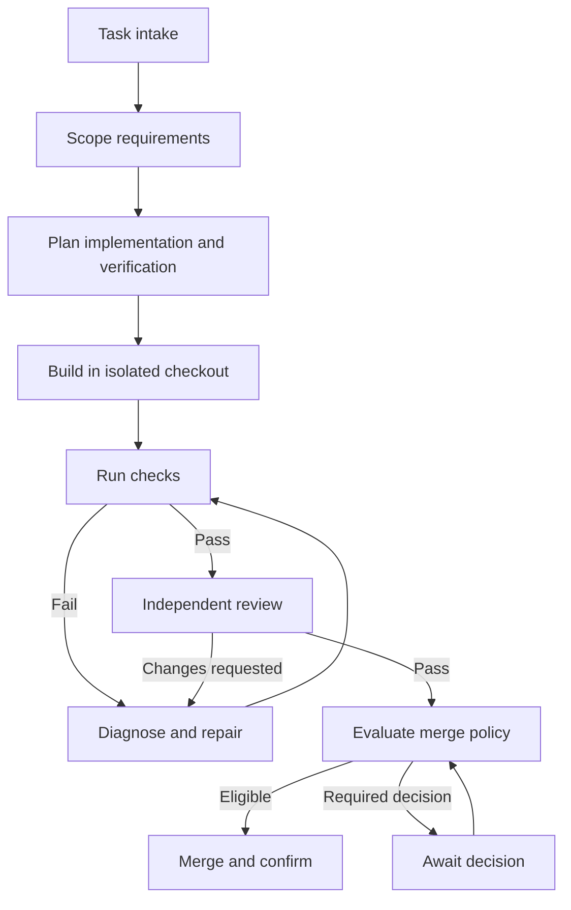

# SDLC factory: initial design

Status: architecture and longer-term contracts. A working single-worker service now implements the first local/remote Git workflow; see README.md for implemented behavior, commands, and limitations. Hosted pull requests, hosted CI gates, container execution, and distributed operation remain future milestones.

## Outcome

Accept a task, turn it into testable requirements, implement it in an isolated checkout, run checks, repair failures, independently review the change, and merge through the repository's configured policy. Persist progress and evidence so interrupted work can resume.

## Workflow

Any change after testing or review invalidates affected evidence and returns to verification. Material scope changes return to scoping. Cancellation, exhausted budgets, ambiguous requirements, and infrastructure failures are explicit states outside the happy path.

## Stage contracts

| Stage | Inputs | Required output | Exit gate |
| --- | --- | --- | --- |
| Intake | Task text, repository, target branch | Task ID, repository configuration, pinned base commit | Repository and execution configuration resolved |
| Scope | Task, repository context | Versioned requirements, acceptance criteria with IDs, non-goals, assumptions, unresolved questions | No unresolved question that changes intended behavior |
| Plan | Requirements, existing architecture | Bounded implementation steps and acceptance-to-verification mapping | Every acceptance criterion has a verification method |
| Build | Plan, isolated checkout | Commit and implementation summary | Change exists within scoped boundaries |
| Verify | Candidate commit, verification plan | Actual command logs, exit codes, acceptance results | Required checks and acceptance criteria pass |
| Review | Requirements, diff, evidence | Structured findings and verdict from a fresh review session | No unresolved blocking findings |
| Merge | Current candidate, review, repository policy | Merge decision and provider result | All required gates apply to the merge candidate |
| Complete | Provider result | Confirmed merged commit and final evidence summary | Repository provider confirms merge |

## Architecture

The orchestrator owns stage transitions. Agents produce proposals and artifacts; application code validates outputs and decides whether gates pass.

- **Task interface:** submit, inspect status, answer a blocking question, cancel, and resume.
- **Durable orchestrator:** persist run state, schedule stages, enforce budgets, and recover interrupted work.
- **Repository adapter:** create checkouts and branches, inspect diffs, open or update pull requests, retrieve checks, and request merges.
- **Agent adapter:** run scoping, planning, implementation, repair, and review with stage-specific instructions and permissions.
- **Verification runner:** execute configured checks and record results independently of agent summaries.
- **Evidence store:** retain requirement revisions, commits, logs, review findings, decisions, and external operation IDs.
- **Policy evaluator:** determine merge eligibility from validated evidence and repository rules.

Start with one repository and sequential task execution. Role separation does not require concurrent workers. Review uses a fresh session with the requirements, diff, and verification evidence.

## Durable records

- `Task`: ID, original request, repository, target branch, configuration revision.
- `Run`: task ID, stage, status, requirement revision, base and candidate commits, budgets, timestamps.
- `StageAttempt`: stage, attempt number, input references, worker lease, outcome, error category.
- `Artifact`: type, storage reference, content hash, requirement revision, applicable commits.
- `CheckResult`: check identity, command, environment, exit code, logs, applicable commit.
- `Review`: reviewed commits and requirement revision, findings with stable IDs, disposition, verdict.
- `Decision`: question or policy rule, authorized actor, answer, applicable revision.
- `ExternalOperation`: idempotency key, request, provider ID, confirmed outcome.

Use an append-only event trail alongside the latest run state. Make state changes and work scheduling transactional. Persist credentials separately from run data and logs.

## Repair and recovery

1. Classify a failure as implementation, unmet requirements, review finding, infrastructure, or missing decision.
2. Give repair the failing evidence and scoped requirements.
3. Repeat all required checks for the resulting commit, then repeat review.
4. Bound repair attempts, elapsed time, and model spending per task. Stop with a concrete failure report when a limit is reached.
5. Retry transient infrastructure failures separately; a retry must not silently widen scope or weaken a check.
6. On restart, reconcile external operations before retrying them. An uncertain merge response must be checked against the provider before another request.
7. Use worker leases and idempotency keys so duplicate events cannot create competing runs or duplicate pull requests.

## Merge policy

Merge is a supported terminal action. Eligibility is configurable per repository and task class.

- All required acceptance checks pass, with recorded execution evidence.
- Repository-required checks and approvals are satisfied.
- Independent review has no unresolved blocking findings.
- Candidate commit and requirement revision match the evidence and decisions.
- Changes to code, tests, workflow, or scope trigger the relevant gates again. Agents cannot approve their own changes to factory policy.
- If the target branch advances, validate integration with that target again through a merge queue or refresh-and-reverify process. Evidence must identify the tested integration candidate.
- Use provider-side branch rules and conditional merge operations to prevent a race between checking eligibility and merging.
- Mark success only after the provider confirms the merge; retain the resulting commit ID.

Optional human decisions should be defined by repository policy, such as material scope ambiguity or specified classes of changes. The system should not ask repeatedly for decisions already recorded for the same revision.

## Repository configuration

Each repository supplies its target branch, setup commands, required build/test/lint/type checks, acceptance verification conventions, review policy, merge method, permitted execution environment, task budgets, and secrets bindings.

Discover existing CI and repository instructions before proposing configuration. Treat task text and repository content as inputs, not authority to change factory permissions or merge policy. A worktree isolates Git changes; use a sandbox or container when process isolation is required.

## Implementation sequence

1. Implement task intake, persisted state transitions, status inspection, and fake adapters. Exercise the entire workflow without model or repository credentials.
2. Connect one real repository and an agent runtime. Complete one small task through scoping, build, verification, repair, and review.
3. Add pull request integration and merge execution with candidate-specific evidence and provider-side enforcement.
4. Demonstrate restart recovery, duplicate delivery handling, budget exhaustion, and cancellation.
5. Add multiple workers or repositories only after the single-task path is reliable.

## Factory acceptance scenarios

- A small task produces scoped requirements, a passing change, an independent review, and a confirmed merge.
- An intentionally failing acceptance check returns the task to repair without merging.
- A review finding forces a revision and invalidates the previous check/review evidence.
- New commits or a moving target branch prevent stale evidence from authorizing merge.
- A process restart after pull request creation or an uncertain merge response resumes without duplicate external operations.
- Duplicate task events result in one active run.
- A task that cannot converge exits within its budget with actionable evidence.
- An unresolved behavioral question waits for an answer while preserving the run.

## Initial implementation decisions

User decisions: build a separate service that can use different models; no target repository currently exists.

Initial implementation: Python standard-library HTTP API, SQLite state, one stage worker, isolated Git clones, stateless OpenAI-compatible and Anthropic adapters, configurable per-stage model routing, and a deterministic demo repository. Runtime model choice is independent of orchestration. Git push provides conditional fast-forward merge for the first adapter. The first implementation uses model-call and execution-time budgets; dollar spending enforcement remains future work.

Official runtime references:

- [Codex SDK](https://learn.chatgpt.com/docs/codex-sdk): programmatic local Codex execution and resumable threads.
- [OpenAI agent runtime options](https://developers.openai.com/api/docs/guides/agents): SDK and managed runtime choices.
